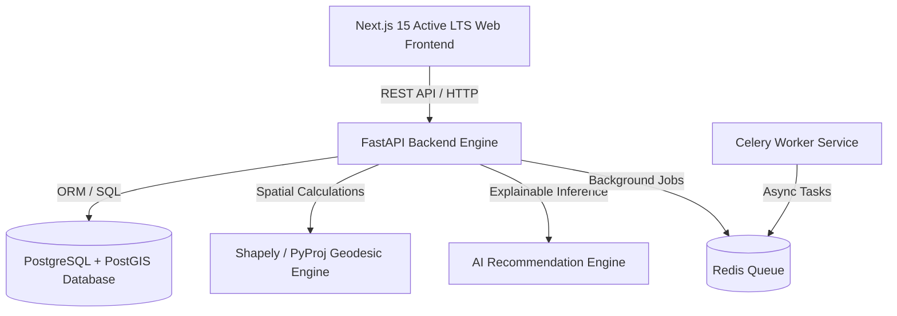

# GreenCity AI — Technical Architecture

## Overview
GreenCity AI is built as a modular monorepo combining a high-performance Python FastAPI geospatial REST API backend, PostgreSQL + PostGIS spatial database, Shapely geodesic computational engine, Redis worker queue, and a Next.js React TypeScript web frontend.

## System Layers
1. **Frontend (`apps/web`)**: Next.js 15 (React 19), Tailwind CSS, Leaflet GIS Map, Recharts, Lucide Icons, Zustand state management.
2. **Core API (`apps/api`)**: FastAPI + Python 3.13, Pydantic v2 validation, SQLAlchemy 2, JWT authentication, RBAC authorization middleware.
3. **Geospatial Engine (`apps/api/services/gis_service.py`)**: Shapely polygon geodesic area calculation, centroid resolution, point-in-polygon spatial queries, GeoJSON feature collection builders.
4. **Ecosystem & AI Service (`apps/api/services/`)**: IPCC/i-Tree canopy carbon storage and sequestration formulas, 300m/500m/1km accessibility catchments, weighted green health matrix (0-100), and explainable intervention recommendations.
