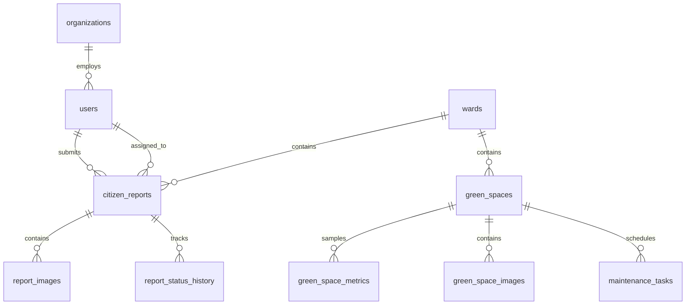

# GreenCity AI — Database Architecture & Schema

## Authoritative GIS Database: PostgreSQL + PostGIS

The primary production database uses PostgreSQL with PostGIS extensions. For fast local development and testing, SQLAlchemy provides a seamless fallback with Shapely GeoJSON geometry math.

## Entity Table Dictionary
- `users`: User profiles with roles (`CITIZEN`, `OFFICER`, `PLANNER`, `ADMIN`, `SUPER_ADMIN`).
- `organizations`: Municipal corporations and environmental directorates.
- `wards`: Administrative ward boundaries with polygon geometries and target green coverage %.
- `green_spaces`: Green space records containing PostGIS geometry, area_m2, canopy %, health score, carbon stored, and accessibility score.
- `citizen_reports`: Public complaints with workflow status (`Submitted`, `Under Review`, `Assigned`, `In Progress`, `Resolved`, `Closed`).
- `maintenance_tasks`: Scheduled municipal work orders (Pruning, Irrigation, Planting).
- `ai_recommendations`: Explainable AI recommendations with supporting metrics and confidence levels.
- `datasets`: GIS import records and processing status.
- `audit_logs`: Immutable security audit trails.
